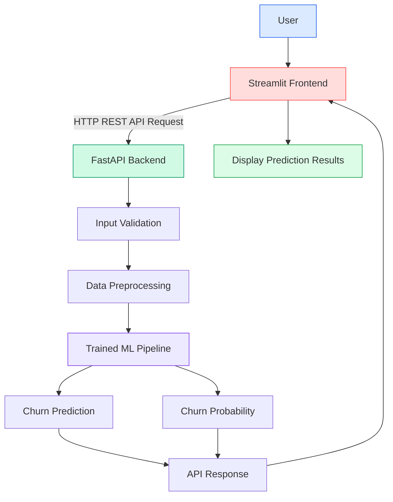
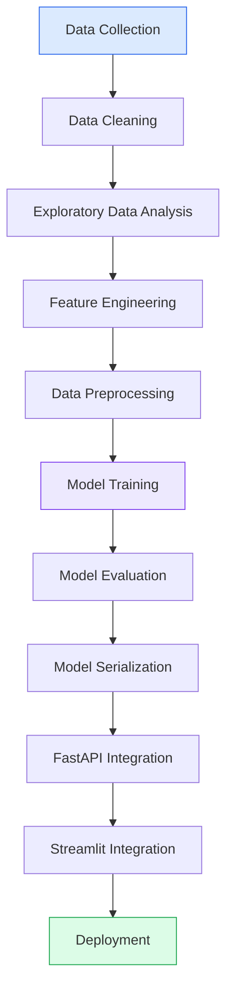
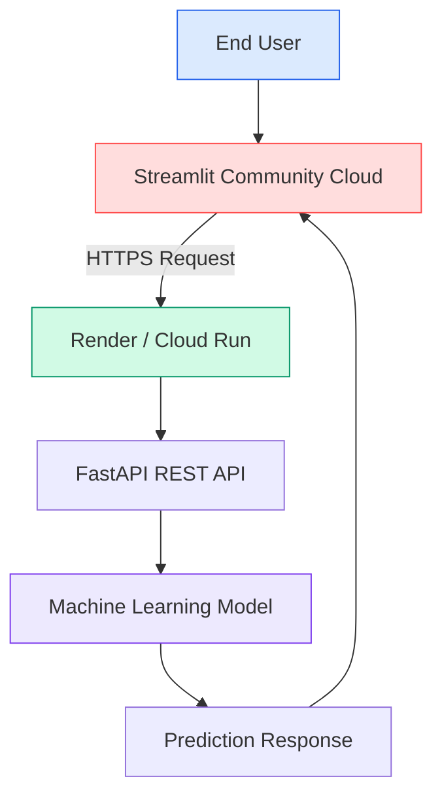

# Customer Churn Prediction

<p align="center">
  
  
  
  
  
</p>

<p align="center">
  An end-to-end Machine Learning application that predicts customer churn using customer information, account details, and service usage patterns.
</p>

---

## Project Overview

Customer churn is a major challenge for businesses, especially subscription-based companies.

This application uses a Machine Learning classification model to predict whether a customer is likely to leave a company and estimate the probability of churn.

The project integrates Machine Learning with FastAPI and Streamlit to provide a complete end-to-end prediction application.

## Application Preview

<!-- Add your application screenshot here -->

<p align="center">
  
</p>

## Features

- Customer churn prediction using Machine Learning.
- Data preprocessing and feature transformation.
- Scikit-learn model pipeline.
- FastAPI REST API integration.
- Interactive Streamlit dashboard.
- Churn probability calculation.
- API input validation and error handling.
- Modular frontend and backend architecture.

## Technology Stack

| Category | Technology |
|---|---|
| Programming Language | Python |
| Data Processing | Pandas, NumPy |
| Machine Learning | Scikit-learn |
| Model Serialization | Joblib |
| Backend | FastAPI |
| Frontend | Streamlit |
| API Testing | Swagger UI |
| Version Control | Git and GitHub |

## Project Architecture



## Project Structure

```text
customer-churn-prediction/
│
├── app/
│   └── main.py
│
├── frontend/
│   └── app.py
│
├── model/
│   └── customer_churn_model.pkl
│
├── data/
│
├── notebooks/
│
├── screenshots/
│   └── dashboard.png
│
├── requirements.txt
├── .gitignore
└── README.md
```

## Machine Learning Workflow



## Installation and Setup

### 1. Clone the Repository

```bash
git clone https://github.com/YOUR_USERNAME/customer-churn-prediction.git
```

### 2. Navigate to the Project Directory

```bash
cd customer-churn-prediction
```

### 3. Create a Virtual Environment

```bash
python -m venv venv
```

### 4. Activate Virtual Environment

For Windows:

```bash
venv\Scripts\activate
```

### 5. Install Dependencies

```bash
pip install -r requirements.txt
```

**Note:** The scikit-learn version must match the version used during model training. This project uses scikit-learn 1.6.1.

## Running the Application

The application consists of two independent components:

- FastAPI Backend
- Streamlit Frontend

### 1. Start FastAPI Backend

Open the first terminal:

```bash
uvicorn app.main:app --reload
```

Backend URL:

http://127.0.0.1:8000

### 2. Access API Documentation

Open your browser:

http://127.0.0.1:8000/docs

### 3. Start Streamlit Frontend

Open a second terminal:

```bash
streamlit run frontend/app.py
```

Frontend URL:

http://localhost:8501

**Important:** Keep the FastAPI backend running while using the Streamlit frontend.

## API Documentation

### POST /predict

Accepts customer information and returns a churn prediction with its probability.

**Example Response:**

```json
{
  "prediction": "Yes",
  "churn_probability": 0.75
}
```

*Illustrative response only.*

## Deployment Architecture

The application can be deployed using separate frontend and backend hosting services.



### Recommended Deployment Platforms

| Component | Platform |
|---|---|
| Frontend | Streamlit Community Cloud |
| Backend | Render |
| Cloud Alternative | AWS / GCP / Azure |
| Containerization | Docker |

## Future Improvements

- [ ] Add model evaluation visualizations.
- [ ] Implement model tracking using MLflow.
- [ ] Add Docker containerization.
- [ ] Implement CI/CD using GitHub Actions.
- [ ] Add model monitoring and performance tracking.
- [ ] Develop an advanced customer analytics dashboard.
- [ ] Improve model performance through hyperparameter tuning.

## Learning Outcomes

This project demonstrates practical experience with:

- Machine Learning model development.
- Data preprocessing and classification.
- REST API development using FastAPI.
- Frontend integration using Streamlit.
- Model serialization and inference.
- End-to-end ML application development.
- Git and GitHub project management.
- ML application deployment.

## Author

**Vishal**

GitHub: https://github.com/Vishusing

---

<p align="center">
  If you find this project useful, consider giving it a ⭐ on GitHub!
</p>
